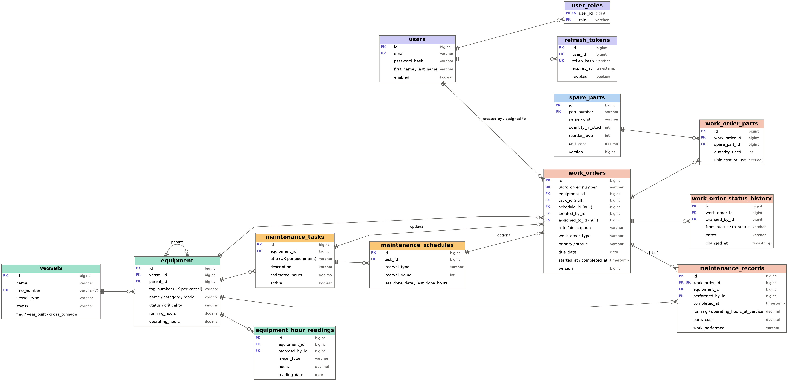

# Database design

13 tables in four groups. The schema is generated by Hibernate from the JPA entities in
`backend/src/main/java/com/example/maintenance/domain` (H2 in dev, MySQL in prod).

| Colour | Group | Tables |
|---|---|---|
| Purple | Users and authentication | `users`, `user_roles`, `refresh_tokens` |
| Green | Fleet | `vessels`, `equipment`, `equipment_hour_readings` |
| Yellow | Preventive maintenance planning | `maintenance_tasks`, `maintenance_schedules` |
| Blue | Inventory | `spare_parts` |
| Orange | Execution and history | `work_orders`, `work_order_parts`, `work_order_status_history`, `maintenance_records` |

## Table reference

| Table | Purpose | Key constraints |
|---|---|---|
| `users` | Accounts with a BCrypt password hash | `email` unique |
| `user_roles` | One row per role (`ADMIN`, `SUPERINTENDENT`, `ENGINEER`) | PK `(user_id, role)` |
| `refresh_tokens` | Hashed refresh tokens with expiry and revoked flag | `token_hash` unique |
| `vessels` | The fleet | `imo_number` unique (7 digits) |
| `equipment` | Onboard machinery; nests through `parent_id` (engine, then its pump) | `(vessel_id, tag_number)` unique |
| `equipment_hour_readings` | History of running/operating hour-meter readings | FK `equipment_id` |
| `maintenance_tasks` | Reusable job definitions for one piece of equipment | `(equipment_id, title)` unique |
| `maintenance_schedules` | Makes a task preventive: every N days, running hours or operating hours | FK `task_id` |
| `spare_parts` | Stock with reorder level, unit cost and an optimistic-lock `version` | `part_number` unique |
| `work_orders` | A job to do, with priority, status, assignee, due date; optimistic-lock `version` | `work_order_number` unique |
| `work_order_parts` | Parts consumed by a work order; unit cost is frozen at time of use | `(work_order_id, spare_part_id)` unique |
| `work_order_status_history` | Append-only audit trail of every status change | FK `work_order_id` |
| `maintenance_records` | Permanent history entry written when a work order completes | `work_order_id` unique (1 to 1) |

## Design decisions

**Preventive schedules are computed, not flagged.** A schedule stores `last_done_*` and
`next_due_*`. Whether it is `OK`, `DUE_SOON` or `OVERDUE` is calculated on read from today's date
and the equipment's current hour meter (`DueCalculator`), so it can never be stale. Calendar
schedules use the date columns; hour schedules use the hour columns.

**Two hour meters per equipment.** `running_hours` and `operating_hours` live on `equipment` (the
current value). `equipment_hour_readings` keeps the history. Meters can only move forward.

**Work order number comes from the primary key.** `WO-2026-00042` is formatted from the generated
id, so it is unique with no counter table and no race condition.

**History is snapshotted.** `maintenance_records` copies the hour-meter values at the moment of
service and `work_order_parts.unit_cost_at_use` copies the price, so old records stay correct when
meters advance or prices change.

**Concurrency.** `work_orders.version` and `spare_parts.version` give optimistic locking: two people
changing the same work order, or drawing the last spare at once, cannot silently overwrite each other
(the loser gets HTTP 409).

**Deletion rules.** Records that have history are not deleted. A vessel with equipment, equipment with
tasks or work orders, a task with schedules or work orders, and a part used on a work order all return
HTTP 409 with a message pointing to the alternative (decommission, deactivate, mark out of service).

**Integrity rules enforced in the service layer**
- Equipment `parent` must be on the same vessel and cannot create a loop.
- A task's equipment, and a schedule's task, cannot be changed after creation.
- Work orders cannot be raised for a `DECOMMISSIONED` vessel.
- Parts can only be added to or removed from a work order that is `IN_PROGRESS`; stock is decremented
  or restored in the same transaction.

## Indexes

Indexes exist on every foreign key used for lookups (`equipment.vessel_id`, `maintenance_tasks.equipment_id`,
`work_orders.equipment_id`, `work_orders.status`, `maintenance_records.equipment_id`,
`maintenance_records.completed_at`, history by work order) plus the unique business keys above.
